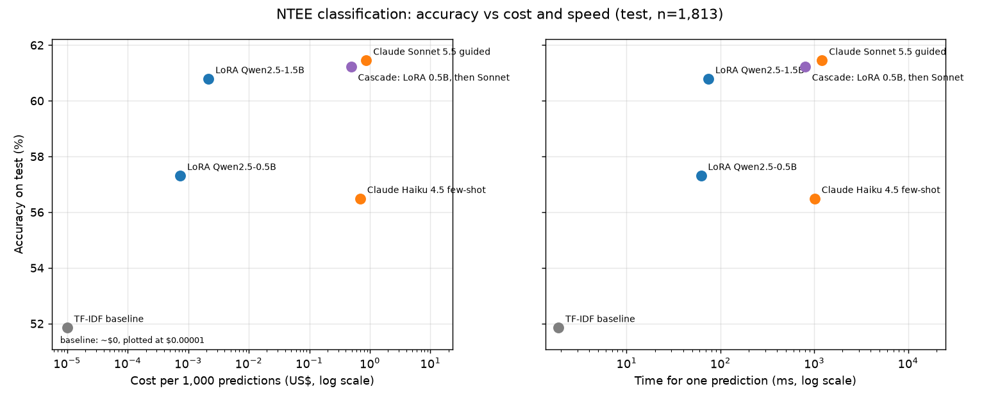
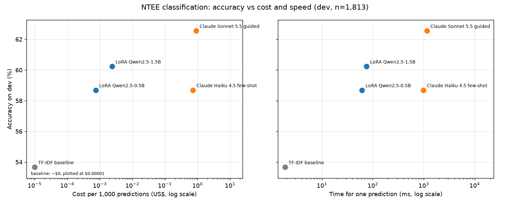
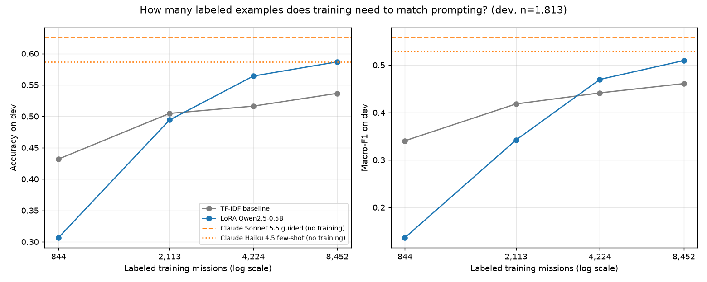
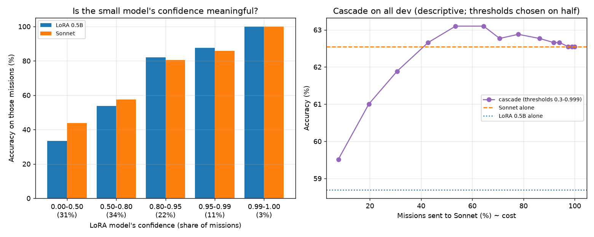
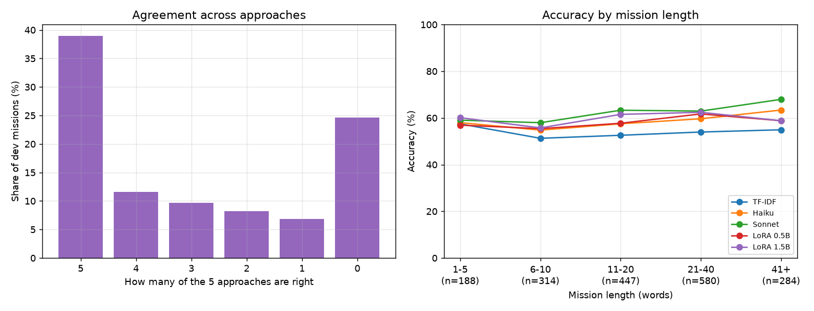

# ntee-classification

Project 4 of the AI Engineer roadmap: **fine-tune or prompt?** One real classification task, solved three ways and compared on accuracy, latency and cost:

1. a **classic baseline**: TF-IDF features and logistic regression;
2. a **prompted frontier model**: Claude, given the categories and their descriptions;
3. a **small open model fine-tuned with LoRA** (about 0.5-1.5B parameters), trained in Google Colab.

**The task:** read a nonprofit's mission statement, as filed on its IRS Form 990, and assign its NTEE major group: the first letter of its National Taxonomy of Exempt Entities code, 26 groups such as A (Arts, Culture and Humanities), B (Education), E (Health Care), P (Human Services) and X (Religion-Related). Results are also reported for the 10 broader categories the groups roll up into.

Plain language: a frontier model like Claude can classify text well with no training, but every prediction costs money and time. A small model trained on thousands of labeled examples can be cheaper and faster per prediction, but it needs data, a GPU and tuning. A simple statistical model may be good enough. Which one wins depends on the task, the data and the volume, and this project measures it instead of guessing.

Released as `ntee-classification-v1.0.0`.

## Results (v1.0.0)

On the **held-out test split** (1,813 missions, scored once at the end; every choice was made on dev):

| Approach | Accuracy | Top-3 | Macro-F1 | One prediction | Cost per 1,000 | Training |
|---|---|---|---|---|---|---|
| TF-IDF + logistic regression | 51.8% | 73.9% | 0.449 | 2 ms (CPU) | ~$0 | 18 s on a laptop |
| LoRA Qwen2.5-0.5B | 57.3% | 80.5% | 0.490 | 62 ms | $0.0007 | 9 min on a T4 (~$0.05) |
| LoRA Qwen2.5-1.5B | 60.8% | 82.3% | 0.531 | 74 ms | $0.0022 | 21 min on a T4 (~$0.12) |
| Claude Haiku 4.5, few-shot | 56.5% | 78.8% | 0.513 | 1,012 ms | $0.69 | none |
| Claude Sonnet 5.5, guided | **61.4%** | **83.0%** | **0.547** | 1,214 ms | $0.87 | none |
| Cascade: LoRA 0.5B, unsure missions to Sonnet | 61.2% | 81.9% | 0.544 | 799 ms (mean) | $0.49 | the 0.5B model's |



- **A fine-tuned 1.5B model came within a point of Claude Sonnet** (60.8% vs 61.4%, inside the noise of about ±2 points; 2.3 points behind on dev) at about 1/400th of the cost per prediction and 16 times faster. The 0.5B model matched Claude Haiku (57.3% vs 56.5%) at about a thousandth of the cost. Sonnet keeps the edge on the small groups with a distinctive meaning (macro-F1 0.547 vs 0.531).
- **Fine-tuning needs labeled data; prompting doesn't.** Below about 2,000 labels the TF-IDF baseline beats the fine-tuned model; the crossover is between about 2,000 and 4,000 ([step 5](#how-much-labeled-data-does-training-need)). Here the IRS supplies the labels for free; where they'd have to be made, prompting wins for a long time.
- **The cascade matched Sonnet at 56% of its cost** (61.2% vs 61.4%, paired bootstrap interval -0.9 to +0.5 points), with the threshold chosen on dev. Its small lead on dev (+1.1) didn't replicate: it was noise in choosing the threshold.
- **Much of the remaining error is the labels.** All five approaches are wrong on about a quarter of missions, and in a blind check the user disputed the IRS label on 72% of those (0% of controls), usually agreeing with Sonnet's answer. That puts the reachable accuracy against these labels near 80%, not 100% ([step 6](#error-analysis-step-6)).

Every approach scored 1-2 points lower on test than on dev except the 1.5B model (+0.6), as expected when choices are made on dev; the ranking held. Total spend: $7.73 in Claude API calls (step 3's pilots and dev runs, $4.89, and the test runs, $2.84) and about $0.60 of GPU time at on-demand T4 prices (nine training runs, about 100 minutes), run on Colab's free tier.

## Why this task

- **Real, public labels.** The IRS Exempt Organizations Business Master File gives organizations' NTEE codes; the Form 990 e-file XML gives their mission statements (Projects 2 and 3 already work with both). No labels are generated by a model.
- **Genuinely hard.** Missions are messy ("EDUCATION HUNTING WITH BOW", all-caps text, typos), some groups overlap (a hospital foundation: health or philanthropy?), and NTEE codes themselves are known to be noisy, so label quality is part of the study.
- **Continues the nonprofit series** started in Project 2.

## Plan

| Step | What | Runs on |
|---|---|---|
| 0 | Scaffolding: uv project, ruff, pytest, CI with change detection, dependency audit | PC |
| 1 | Dataset: missions and NTEE codes from IRS data; cleaning, deduplication, stratified train/dev/test split with a held-out test set; a label-quality check on a hand-graded sample | PC |
| 2 | Classic baseline (TF-IDF + logistic regression) and the eval harness: accuracy, macro-F1, per-class results, confusion matrix, latency, cost | PC |
| 3 | Prompted Claude: zero-shot and few-shot, structured output, model comparison, batching and caching for cost | Claude API |
| 4 | LoRA fine-tuning of a small open model | Google Colab |
| 5 | The comparison: accuracy vs latency vs cost per 1,000 predictions, how much training data fine-tuning needs to beat prompting, and a cascade of the two | PC + Colab |
| 6 | Error analysis: label noise, confusable groups, short missions | PC |
| 7 | Write-up and release (`ntee-classification-v1.0.0`) | |

## Dataset (step 1)

[`data/dataset.csv`](data/dataset.csv): **12,078 mission statements** labeled with their NTEE major group, built by [`src/build_dataset.py`](src/build_dataset.py) from public IRS data. Columns: `ein`, `form` (990 or 990EZ), `tax_period`, `mission`, `ntee_code` (full code, e.g. B25), `group` (its first letter), `broad` (the broad category), `split`.

**Sources.** Labels: the IRS Exempt Organizations Business Master File (1,399,764 organizations with an NTEE code, streamed; only EIN and code kept). Text: one monthly e-file XML batch (`2025_TEOS_XML_06A`): Form 990 Part I line 1 (Part III as fallback) and Form 990-EZ's primary exempt purpose. The ZIP is downloaded, read and deleted.

**How 36,224 returns became 12,078 examples** (full counts in [`data/stats.json`](data/stats.json)):

| Stage | Returns |
|---|---|
| Form 990/990-EZ returns with a mission | 36,224 |
| No NTEE code in the master file | -9,744 |
| Too short (under 15 characters) or a placeholder ("N/A", "SEE SCHEDULE O") | -939 |
| Group Z, "Unknown, Unclassified" (not a predictable category) | -178 |
| Same organization twice (latest return kept) | -758 |
| Same mission text, same group (collapsed) | -247 |
| Same mission text, **different groups** (all copies dropped) | -429 |
| Unique, usable pool | 23,929 |
| Sampled in the natural mix, topped up to 100 per group where possible | **12,078**: 8,452 train / 1,813 dev / 1,813 test |

The split is stratified by group with a fixed seed, and no organization or mission text appears twice, so nothing in test was seen in training. The test split is held out until each approach's final score.

**What it looks like.** 25 groups (Z excluded). Largest: P Human Services (1,634), B Education (1,614), A Arts (1,253), N Recreation and Sports (1,065), X Religion (820). Smallest: V Social Science has only 41 (all there were); H and U exactly 100. Religion is underrepresented relative to how many religious organizations exist, because churches don't have to file a Form 990. Missions are short: median 130 characters, 10% under 36. 63% come from Form 990, 37% from the 990-EZ.

**How good are the labels?** The user graded 50 random training examples from the mission text alone ([`data/label_check.md`](data/label_check.md)):

| Verdict | Share |
|---|---|
| Agree with the IRS group | 74% (37) |
| Unsure: several groups fit ("could be B or K also") | 20% (10) |
| Disagree | 6% (3) |

Clear errors are rare and mostly missions too short to tell ("RESIDENT SERVICES" coded as recreation). The bigger issue is **ambiguity**: an NTEE code is one label, but many organizations do several things. So exact-group accuracy has a realistic ceiling of roughly **75-90%**, not 100%, and results are also reported as top-3 accuracy and broad-category accuracy.

Two disagreements are **NTEE conventions**, not mistakes: a Christ-centered school is coded B (Education), because organizations are classified by primary activity, not motivation; and a school-athletics booster club is coded with the schools (B), not sports (N). Models trained on the data can learn such conventions; a prompted model has to be told them. That's a hypothesis for the comparison in step 5.

## Classic baseline and the eval harness (step 2)

**The harness** ([`src/evaluate.py`](src/evaluate.py)) scores every approach the same way. Each approach gives a ranked list of groups per mission; the harness reports **accuracy** (exact group), **top-3**, **macro-F1** (every group counts equally, so ignoring rare groups shows), **broad-category accuracy**, per-group precision/recall/F1, the most common confusions, **latency** for one prediction and **cost per 1,000 predictions**. Each run is saved with every prediction in `results/<approach>_<split>.json` and summarized in `results/history.csv`. [`src/data.py`](src/data.py) refuses to load the test split without `final=True`.

**The baseline** ([`src/baseline.py`](src/baseline.py)): TF-IDF features (word unigrams and bigrams, plus character 3-5-grams for typos and all-caps text) into a logistic regression, settings chosen on dev from a 12-way grid.

| Dev split (1,813 missions) | Result |
|---|---|
| Accuracy | **53.7%** |
| Top-3 | 75.4% |
| Macro-F1 | 0.461 |
| Broad category | 63.9% |
| Latency / cost | 1.8 ms per mission on a laptop CPU / ~$0 |
| Training | 18 seconds, 60,221 features |

The grid showed character features adding 1-3 points and rare-group weighting adding 0.04-0.10 macro-F1 at no accuracy cost. Weakest groups: V Social Science (6 dev examples, F1 0), R Civil Rights (0.11), U Science and Technology (0.24). The dev score is slightly optimistic because settings were chosen on dev; the test split is scored once, at the end.

**Where it fails**, the starting point for step 6:

- **Support organizations.** 7.3% of missions carry a "single organization support / fundraising" code (x11, x12), which NTEE files under the cause supported; the baseline often calls them T (Philanthropy). Missions mentioning raising funds or support score 47.8%.
- **Boilerplate instead of a mission.** "THE CORPORATION IS ORGANIZED AND SHALL BE OPERATED EXCLUSIVELY FOR CHARITABLE, EDUCATIONAL, SCIENTIFIC..." carries no information about the group (here Arts); no model can get these.
- **Questionable labels.** A fund for soldiers' families and a stamp-collecting society are both coded B99 (Education).

## Prompted Claude (step 3)

[`src/prompted.py`](src/prompted.py) sends each mission to Claude with a system prompt from [`src/prompts.py`](src/prompts.py) and forces the answer into a schema of three ranked guesses, each one of the 25 group letters (structured outputs: no malformed replies, no invented groups). Thinking is off: this is quick labeling. The system prompt is cached. Answers are saved per mission as they arrive, so interrupted runs resume and pilot answers are reused.

Three prompts, each adding to the last: **names** (the task and group names), **guided** (plus a description of each group and the NTEE conventions from steps 1-2: classify by activity, not motivation; support organizations take their cause's group), and **few-shot** (plus 4 labeled training missions per group). Two models: **Claude Haiku 4.5** and **Claude Sonnet 5.5**.

**Pilot** (the same 300 dev missions for every approach, $2.49):

| | Accuracy | Top-3 | Macro-F1 | Cost per 1,000 |
|---|---|---|---|---|
| Baseline (TF-IDF) | 54.3% | 77.3% | 0.445 | ~$0 |
| Haiku: names / guided / few-shot | 53.3% / 58.7% / 59.0% | 80.0% / 78.7% / 80.7% | 0.444 / 0.527 / 0.525 | $1.08 / $1.76 / $0.83 |
| Sonnet: names / guided / few-shot | 61.7% / 63.0% / 63.0% | 85.0% / 83.3% / 82.7% | 0.533 / 0.543 / 0.542 | $0.71 / $0.99 / $2.92 |

**Full dev split** (1,813 missions) for the best value per model:

| | Accuracy | Top-3 | Macro-F1 | Broad | Cost per 1,000 (batch) | Median latency |
|---|---|---|---|---|---|---|
| Baseline | 53.7% | 75.4% | 0.461 | 63.9% | ~$0 | 1.8 ms |
| Claude Haiku 4.5, few-shot | 58.7% | 80.3% | 0.529 | 69.8% | $0.72 ($0.36) | 984 ms |
| **Claude Sonnet 5.5, guided** | **62.5%** | **83.1%** | **0.558** | **70.8%** | $0.90 ($0.45) | 1,149 ms |

What the runs showed:

- **Claude beats the baseline by 5-9 points, about 500 times slower.** Still far below the 75-90% ceiling for exact groups; top-3 (83%) is much closer, consistent with the ambiguity found in step 1: the IRS group is usually among Claude's guesses, just not first.
- **Its gains are on small groups with a distinctive meaning**, where the baseline saw too few training examples: R Civil Rights (F1 0.11 to 0.42), U Science and Technology (0.24 to 0.47), H Medical Research (0.39 to 0.58), C Environment (0.66 to 0.84). No gain on the fuzzy groups whose definitions overlap everything (S Community Improvement 0.49, T Philanthropy 0.30 to 0.32, W Public Benefit 0.31 to 0.34). Most remaining errors are neighboring service categories: health vs human services, human services vs community, education and youth.
- **Prompting matters more for the smaller model**: descriptions and conventions lifted Haiku 5.4 points and Sonnet 1.3. Examples added nothing beyond the descriptions for either.
- **The conventions only partly worked**: on support organizations Sonnet went from 12 to 14 of 24 right (baseline 10). Telling a model a rule isn't the same as recognizing when it applies.
- **Caching thresholds decided the costs.** Sonnet 5.5 caches prompts from 512 tokens, Haiku 4.5 from 4,096, and Sonnet's tokenizer counts about 50% more tokens for the same text. So the pricier model was cheaper to run with a cached prompt, and giving Haiku's few-shot prompt 4 examples per group instead of 3 pushed it over its minimum, cutting its cost from about $3.84 to $0.72 per 1,000. One estimate missed that the structured-output schema adds tokens to every request (enough to make a 496-token prompt cache): measure, don't assume.
- No refusals and no fallbacks in 3,926 requests.

Step 3 cost $4.89 in API calls (pilots plus the two full dev runs). Token counting for estimates is free.

## LoRA fine-tuning (step 4)

[`notebooks/finetune_lora.ipynb`](notebooks/finetune_lora.ipynb) (generated by [`make_finetune_notebook.py`](notebooks/make_finetune_notebook.py)) fine-tunes a small open model in Google Colab, because the training needs an NVIDIA GPU this project's PC doesn't have. It reads the dataset from GitHub, trains on the train split, keeps the epoch with the best dev macro-F1, saves the LoRA adapter to Google Drive, and writes a predictions file that [`src/finetuned.py`](src/finetuned.py) scores locally with the shared scorer.

**The model**: Qwen2.5 (0.5B or 1.5B parameters, open license) with a 25-way **classification head**: one forward pass scores every group, so there are no malformed outputs and top-3 is defined. With **LoRA**, the base model's weights stay frozen and only small adapter matrices in its attention layers, plus the new head, are trained: 2.2 million parameters for 0.5B, about 0.4% of the model. 3 epochs, learning rate 2e-4, LoRA rank 16, effective batch 32, fp16 mixed precision on a free T4.

| Dev split (1,813) | Accuracy | Top-3 | Macro-F1 | Broad | One prediction | Cost per 1,000 | Training |
|---|---|---|---|---|---|---|---|
| Baseline (TF-IDF) | 53.7% | 75.4% | 0.461 | 63.9% | 1.8 ms (CPU) | ~$0 | 18 s |
| **LoRA Qwen2.5-0.5B** | 58.7% | 80.3% | 0.510 | 67.1% | 67 ms | **$0.0007** | 8.8 min (~$0.05) |
| **LoRA Qwen2.5-1.5B** | 60.2% | 80.8% | 0.516 | 68.0% | 75 ms | $0.0024 | 22.0 min (~$0.13) |
| Claude Haiku 4.5, few-shot | 58.7% | 80.3% | 0.529 | 69.8% | 984 ms | $0.72 | none |
| Claude Sonnet 5.5, guided | **62.5%** | **83.1%** | **0.558** | **70.8%** | 1,149 ms | $0.90 | none |

GPU cost assumes an on-demand T4 at $0.35 an hour, with predictions batched.

What the runs showed:

- **A model trained on 0.4% of its parameters matched Claude Haiku** exactly on accuracy and top-3, at about a thousandth of the cost per prediction and 15 times faster per request. The trade is the GPU, the setup and the model to maintain.
- **It trails Claude Sonnet by 2-4 points, almost all on small groups with a distinctive meaning** (U Science and Technology F1 0.47 vs 0.17, R Civil Rights 0.42 vs 0.26, H Medical Research 0.58 vs 0.43): with a few dozen training examples a small model can't learn what a frontier model already knows. It does better where examples are plentiful (J Employment 0.71 vs 0.62).
- **Three times the size bought 1.5 points.** On the 10 large groups, 1.5B came within about 1 F1 point of Sonnet; on the 8 small ones it didn't improve. The limit is the data, not the model's capacity.
- **The convention hypothesis was only partly confirmed.** On the 123 support and fundraising organizations, the fine-tuned model mostly stopped calling them philanthropy (7 times, vs 18 for the baseline), but got 67 right against Sonnet's 72 with the rule written in its prompt.
- **The models make different mistakes**: Sonnet and the 0.5B model are both right on 51.9% of missions, and at least one is right on 69.3%. That points to combining them, step 5's question.
- **Running it was its own lesson.** Colab's preinstalled packages clashed with the newest PEFT (an old `torchao`), transformers 5 had removed a training argument (`warmup_ratio`), and the 1.5B model ran out of GPU memory at batch size 32. Batches of 8 with gradient accumulation over 4 (updating every 4 batches) behave like 32 without the memory; a first 1.5B run at plain batch 8 scored 61.2%, within noise of the clean 60.2%.

## The comparison (step 5)

Three scripts, all reading saved runs, so none of them calls a model or costs anything: [`src/compare.py`](src/compare.py) (accuracy against cost and speed), [`src/data_size.py`](src/data_size.py) (how much labeled data training needs) and [`src/cascade.py`](src/cascade.py) (the fine-tuned model and Claude combined). The data-size curve needed three more Colab runs of the 0.5B model, on 10%, 25% and 50% of the training missions, and a rerun on all of them that saves the model's probabilities.

### Accuracy, speed and cost



The table is the one in step 4 ([`results/comparison_dev.md`](results/comparison_dev.md)). The cost axis is logarithmic: Claude and the fine-tuned models are three gridlines, about 1,000 times, apart. Training the 0.5B model ($0.05 of GPU time) pays for itself against Claude Haiku after about 71 predictions, but that leaves out what it took to get there: 8,452 labels (free here only because the IRS assigns them), setting up the training, and serving a model. Prompting has almost no fixed cost. Only Sonnet is clearly more accurate than a $0.05 fine-tune, by 2-4 points.

### How much labeled data does training need?



| Labeled training missions | Baseline accuracy | LoRA 0.5B accuracy | Baseline macro-F1 | LoRA 0.5B macro-F1 |
|---|---|---|---|---|
| 844 (10%) | **43.2%** | 30.7% | **0.340** | 0.136 |
| 2,113 (25%) | **50.5%** | 49.4% | **0.418** | 0.342 |
| 4,224 (50%) | 51.6% | **56.4%** | 0.441 | **0.470** |
| 8,452 (100%) | 53.7% | **58.7%** | 0.461 | **0.510** |
| none: Claude Haiku 4.5 few-shot | 58.7% | | 0.529 | |
| none: Claude Sonnet 5.5 guided | 62.5% | | 0.558 | |

The baseline is retrained on stratified subsamples of the same sizes; its full-data point reproduces step 2's 53.7%.

- **With little data, the simple model wins.** At 844 labels TF-IDF is 12 points ahead: it learns "church" or "soccer" from a handful of examples, while the small LLM's new classification head needs many examples to learn 25 classes (macro-F1 0.136: most small groups barely predicted).
- **The crossover is between about 2,000 and 4,000 labels.** Past it, the LLM keeps improving while TF-IDF flattens: understanding language pays off once there are enough examples to attach meaning to the categories.
- **Prompting needs none of it.** Haiku, with 100 examples in its prompt, matches what fine-tuning reached with 8,452 labels. The curve is slowing (+2.3 points from half the data to all of it), so catching Sonnet would plausibly take tens of thousands of labels, under a label-noise ceiling of roughly 75-90%.
- Caveats: every size trained for the same 3 epochs, so the 10% run made about 80 weight updates against about 800, and part of its drop is under-training. Each point is one run, and differences of about 2 points are noise.

### A cascade: the fine-tuned model first, Claude for the rest

The small model answers when its top probability is at least a threshold; other missions go to Sonnet. Simulated from the saved predictions with each Sonnet request's real cost and time.



**Its confidence is meaningful.** Accuracy rises from 33% on missions where the small model's top probability is below 0.5 to 82-100% above 0.8, and there Sonnet is no better (81-100% on the same missions), so paying for Sonnet on them is wasted. Sonnet's advantage is entirely on the low-confidence missions, though even it gets only 44% of the least confident: these are largely the ambiguous missions the label check found.

**The threshold was chosen on a random half of dev and scored on the other half** (907 missions), so the result isn't fitted to the answers it's scored on ([`results/cascade_dev.md`](results/cascade_dev.md)):

| Report half (907) | Accuracy | Sent to Sonnet | Cost per 1,000 | Mean time |
|---|---|---|---|---|
| LoRA Qwen2.5-0.5B alone | 59.4% | 0% | $0.001 | 61 ms |
| Claude Sonnet 5.5 alone | 63.8% | 100% | $0.90 | 1,348 ms |
| **Cascade, threshold 0.7** (cheapest to match Sonnet on the tune half) | **64.9%** | 53% | **$0.48** | **737 ms** |
| Cascade, threshold 0.8 (most accurate on the tune half) | 64.6% | 64% | $0.57 | 885 ms |

- **The cascade matched Sonnet at about half the cost and in about half the time**, and was slightly more accurate: +1.1 points, with a 95% paired bootstrap interval of +0.1 to +2.2. Beating Sonnet is possible because on the confident missions the fine-tuned model is slightly better than Sonnet: it learned the IRS's labeling habits from its training data.
- **There's room left.** At least one model is right on 70.6% of these missions; confidence alone finds only part of that.

**Step 5's answer:** fine-tuning pays off from a few thousand labels; prompting wins with none; and here the best design uses both, a cheap fine-tuned model first and Claude as the fallback for what it's unsure of.

## Error analysis (step 6)

[`src/errors.py`](src/errors.py) reads the five final approaches' dev predictions (no model calls) and asks whether the remaining errors come from the models, the taxonomy or the labels. Full tables: [`results/errors_dev.md`](results/errors_dev.md).



**The approaches fail on the same missions.** All five are right on 39.0% of dev missions, and **all five are wrong on 24.6%**. A keyword counter, two prompted frontier models and two fine-tuned models work in very different ways; when all of them miss the same mission, the mission or its label is the likelier cause.

**The labels on those missions are mostly disputed.** A blind check: 25 missions all five got wrong and 15 control missions, shuffled, graded by the user without knowing which was which (same format as step 1's check, key in [`data/error_check_key.json`](data/error_check_key.json)):

| Missions | Agree with IRS | Unsure | Disagree |
|---|---|---|---|
| All five approaches wrong (25) | 20% | 8% | **72%** |
| Controls (15) | 80% | 20% | 0% |

And where the user disagreed with the IRS (18 missions), the group they picked was Sonnet's answer 16 times (Haiku 13, LoRA 1.5B 14, LoRA 0.5B 11, TF-IDF 11). Examples: "TREATMENT OF ALCOHOLISM" coded A (Arts), "RECREATIONAL SOCCER PROGRAM" coded O (Youth Development) rather than N (Sports), "Educating students." coded P (Human Services). A likely reason: an NTEE code describes the organization, usually assigned once when it applied for exemption and rarely updated, while the mission on a recent 990 may describe what it does now.

What that means, roughly: if 72% of the all-wrong missions have a wrong label, about 18% of dev labels are wrong (an interval of roughly 13-21%, given only 25 graded), so no approach can score much above about 80% against the IRS labels, and Sonnet's accuracy against labels a person agrees with is nearer 75-80% than 62.5%. The estimate rests on one non-expert grader and small samples; the grader also saw the IRS label, which if anything pushes toward agreeing with it. The ranking of the approaches doesn't change, since they're all scored against the same labels.

**The confused pairs are overlapping groups.** Every approach mixes up the same pairs: A-B and B-O (arts education, youth programs in schools), N-O (youth sports), B-T and P-T (foundations supporting a school or a service: step 1's convention), E-G (a hospital vs a disease association), L-S and P-S (housing vs community development). These boundaries are blurry in the taxonomy itself. Two model-specific weaknesses: the 0.5B model confuses Human Services and Religion (36 errors, Haiku 14), meaning faith-based services, and the LLMs confuse Education and Human Services more than TF-IDF (28-33 vs 13).

**Mission length barely matters.** Missions of 1-5 words are no harder (57-60%): short missions often name the activity ("HISTORIC PRESERVATION"). Only Sonnet gains clearly from long missions (68% at 41+ words vs 59% for the fine-tuned models); a larger model uses more context, and the notebook's 128-token limit may clip the longest missions (not tested).

**The cascade routes by group, not length.** Missions sent to Sonnet are as long as those kept (median 20 vs 19 words). It sends most of the small, abstract groups (U Science and Technology 93%, R Civil Rights 89%, T Philanthropy 85%, V Social Science 83%) and least of those with distinctive vocabulary (D Animals 13%, M Public Safety 28%, A Arts 31%). On the missions it sends, even Sonnet is right only 47% of the time: many are the disputed labels above.

**Step 6's answer:** most of the remaining error isn't the models. About a quarter of dev missions defeat every approach, and on most of those a person sides with the models, usually with Sonnet, over the IRS label. Better models will gain little against these labels; cleaner labels, or scoring against human-checked ones, would show more.

## Test scores and release (step 7)

The test split was loaded for the first time here, once per approach, with the settings chosen on dev: the baseline (`python src/baseline.py --final`), the two Claude prompts (`src/prompted.py --final`), both fine-tuned models (the notebook with `FINAL = True`, retrained with the same seed and settings; scored by `src/finetuned.py`), and the cascade with dev's threshold (`src/cascade.py --final`). [`src/compare.py --split test`](src/compare.py) builds the table and chart above ([`results/comparison_test.md`](results/comparison_test.md), [`results/cascade_test.md`](results/cascade_test.md)). All runs are logged in [`results/history.csv`](results/history.csv).

## Future enhancements

1. **A cascade with the 1.5B model.** It nearly matches Sonnet alone, so routing only its unsure missions to Sonnet might beat both. It would need its threshold chosen on dev and, since the test split has now been used, a fresh held-out set for an honest score.
2. **Cleaner evaluation labels.** A few hundred dev and test missions checked by people would measure the approaches against labels a person agrees with, which step 6 suggests matters more than further model gains.
3. **More training data.** The dataset uses one IRS e-file batch of many; the data-size curve was still rising (+2.3 points from half to all the data), so more batches could add a point or two to the fine-tuned models.
4. **Better routing.** Confidence alone finds only part of what the two models could do together (at least one is right on 70.6% of missions); calibrating the small model's probabilities, or routing by group, may do better.
5. **Serving the fine-tuned model.** The 0.5B adapter is small enough to serve from a CPU container, which would make the cost comparison real rather than priced from GPU time.
6. **Cheaper Claude.** The Message Batches API halves Claude's cost for work that can wait (about $0.44 per 1,000 for Sonnet), narrowing but not closing the gap.

## Setup

```powershell
cd ntee-classification
uv sync            # creates .venv with the locked dependencies
uv run pytest      # tests
uv run ruff check . ; uv run ruff format --check .
bash security/audit.sh   # known vulnerabilities in locked dependencies (Git Bash)
```

## Layout

- `src/`: flat modules (`pytest.ini` puts `src` on the import path).
- `tests/`: unit tests, no network and no API calls.
- `data/raw/`: IRS downloads (gitignored, re-downloadable).
- `security/`: the dependency audit and the list of reviewed, accepted vulnerabilities.
